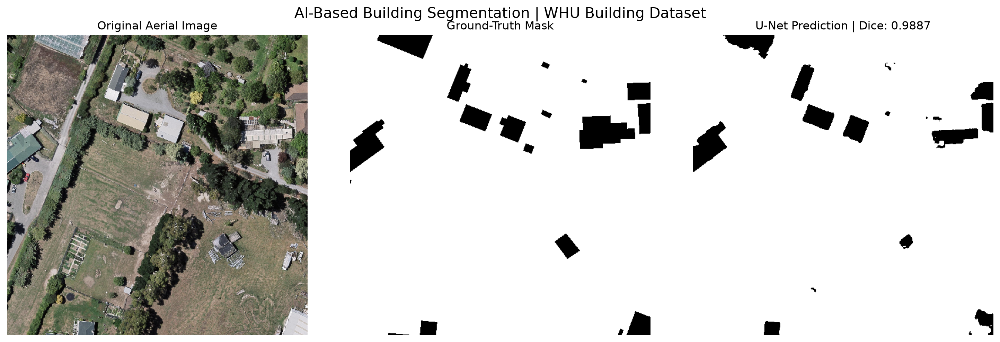
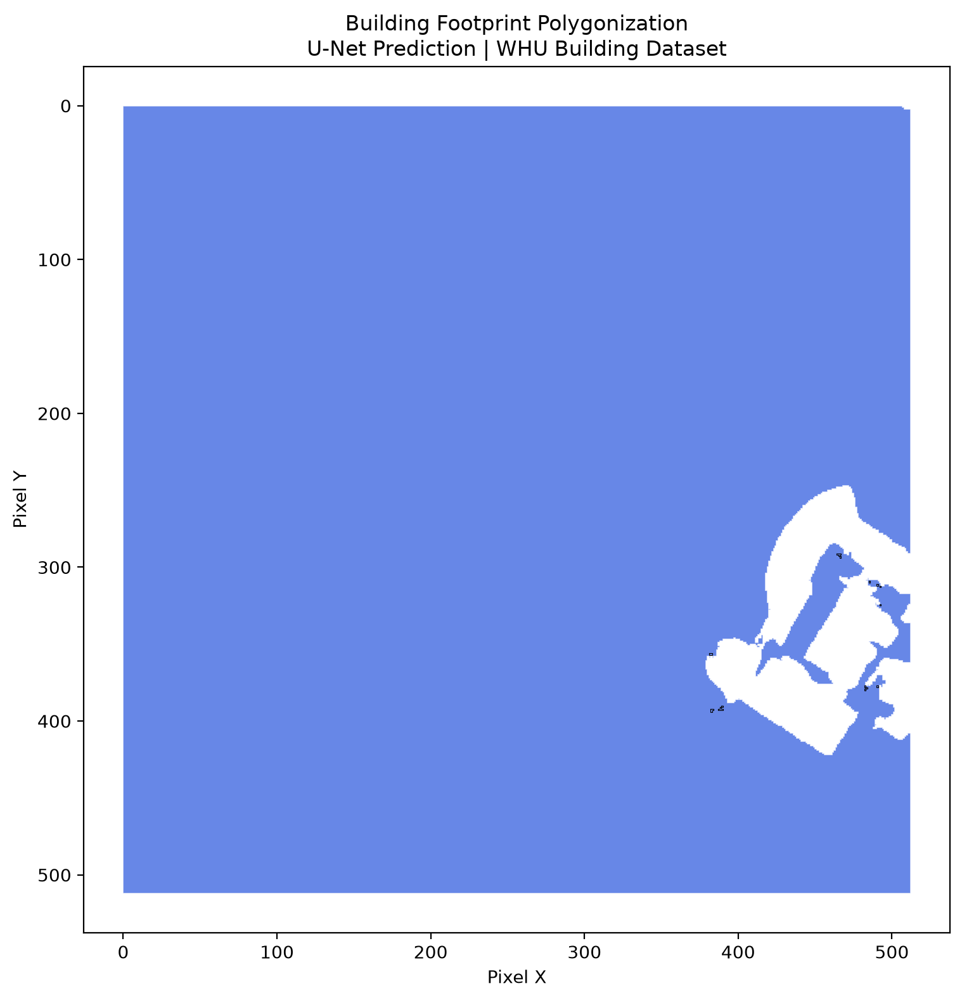

# AI-Based Building Extraction from Aerial Imagery

### A Computer Vision and GeoAI project using U-Net semantic segmentation to extract building regions from aerial imagery.

This project combines deep learning and geospatial processing to identify building regions in high-resolution aerial images and convert predicted segmentation masks into vector geometries.

Built with **PyTorch, U-Net, Rasterio, Shapely, and Streamlit**, the project demonstrates an end-to-end workflow from image input to building-mask prediction and geospatial export.

## Project Overview

Building footprint extraction is an important application of remote sensing, GIS, and computer vision. Reliable building information can support urban mapping, infrastructure planning, and geospatial database development.

This project uses a U-Net convolutional neural network trained on the WHU Building Dataset to perform binary semantic segmentation.

The application allows users to upload an image, generate a building prediction, visualize the segmentation, adjust extraction parameters, and export the results.

### Key Features

- **Deep learning segmentation:** U-Net model implemented using PyTorch.
- **Image inference:** Predict building regions from uploaded aerial imagery.
- **Interactive visualization:** Compare the original image, predicted mask, and segmentation overlay.
- **Adjustable threshold:** Control how predicted probabilities are converted into a binary building mask.
- **Polygon extraction:** Convert predicted building regions into vector geometries.
- **GeoJSON export:** Download extracted polygon features.
- **GeoTIFF export:** Export a binary mask while preserving source georeferencing when available.
- **Geospatial compatibility:** Support georeferenced raster inputs for GIS workflows.
- **Local GPU inference:** Use CUDA acceleration when a compatible GPU and PyTorch installation are available.

## Application Preview

### Building Segmentation

The following image compares the input aerial image, ground-truth building mask, and model prediction.



### Polygon Extraction

The project also explores converting predicted building masks into vector geometries.



## Dataset

The model was developed using the **WHU Building Dataset**, which provides aerial imagery and corresponding building annotations.

The cropped tiles used in this project have the following characteristics:

| Property | Description |
|---|---|
| Image dimensions | 512 × 512 pixels |
| Image format | TIFF |
| Image channels | RGB |
| Image data type | 8-bit unsigned integer |
| Labels | Binary building masks |
| Approximate spatial resolution | 0.3 metres per pixel |

### Dataset Split

| Split | Image-label pairs |
|---|---:|
| Training | 4,736 |
| Validation | 1,036 |
| Test | 2,416 |
| **Total** | **8,188** |

The dataset is not included in this repository because of its size.

Obtain the dataset from its official distribution source and follow its licensing and citation requirements.

Arrange the files as follows:

```text
data/
└── raw/
    └── WHU/
        ├── train/
        │   ├── image/
        │   └── label/
        ├── val/
        │   ├── image/
        │   └── label/
        └── test/
            ├── image/
            └── label/
```

The dataset loader handles the building-label convention used by the corrected training workflow.

## Methodology

### 1. Data Preparation

- Read aerial images and label masks.
- Convert imagery into normalized tensors.
- Convert annotations into binary building masks.
- Apply data augmentation during training.

### 2. Model Architecture

The project uses a U-Net convolutional neural network for binary semantic segmentation.

U-Net consists of an encoder that learns image features and a decoder that reconstructs spatially detailed predictions. Skip connections help preserve spatial information between corresponding stages.

| Component | Implementation |
|---|---|
| Model | U-Net |
| Framework | PyTorch |
| Task | Binary semantic segmentation |
| Output | Building probability map and binary mask |
| Acceleration | CUDA when available |

### 3. Training and Evaluation

The training workflow uses a combination of binary cross-entropy and Dice loss.

The project includes training and validation workflows, model checkpoint saving, and evaluation using segmentation metrics.

The primary evaluation metrics are:

- Dice coefficient
- Intersection over Union (IoU)
- Precision
- Recall

**Important:** Metric values must be associated with the specific checkpoint, mask convention, and evaluation procedure that produced them. Results from an earlier model configuration should not be treated as the performance of the corrected checkpoint.

### 4. Building Prediction

The inference pipeline loads the trained U-Net checkpoint and generates building probabilities for an input image.

For larger images, overlapping tiles are used to process the image in manageable sections. Predictions from overlapping regions are combined before thresholding.

A probability threshold converts the resulting probability map into a binary building mask.

### 5. Polygon Extraction

The binary mask can be converted into polygon geometries using raster-to-vector processing.

Rasterio and Shapely support polygon generation and geometry handling. A minimum-area filter helps remove small regions that may represent unwanted detections.

Adjacent buildings can merge into a single connected region. Consequently, successful pixel-level segmentation does not guarantee that every individual building will be represented by a separate, geometrically accurate polygon.

## Running the Application

### Prerequisites

- Python 3.11 recommended
- A compatible PyTorch installation
- The trained model checkpoint
- Sufficient memory for the input imagery
- CUDA-compatible hardware for GPU acceleration, if desired

### 1. Clone the Repository

```bash
git clone https://github.com/NeerajKumarcodes/computer-vision-satellite-imagery.git
cd computer-vision-satellite-imagery
```

### 2. Create a Virtual Environment

```bash
python -m venv .venv
```

On Windows PowerShell, activate it using:

```powershell
.\.venv\Scripts\Activate.ps1
```

### 3. Install Dependencies

```bash
python -m pip install --upgrade pip
pip install -r requirements.txt
```

For GPU inference, install a PyTorch build compatible with your CUDA environment. Consult the [official PyTorch installation guide](https://pytorch.org/get-started/locally/) if setting up a new environment.

### 4. Prepare the Model Checkpoint

The trained model checkpoint is not included in this repository.

Place the appropriate checkpoint at the path expected by the inference code:

```text
models/
└── unet_corrected_best.pth
```

The checkpoint must match the model architecture and label convention expected by the inference pipeline.

### 5. Launch the Application

From the repository root, run:

```bash
streamlit run app.py
```

Streamlit will provide a local address for opening the application in your browser.

### 6. Run Building Extraction

1. Upload an aerial image or supported raster file.
2. Adjust the probability threshold and minimum polygon area as needed.
3. Generate the building prediction.
4. Inspect the segmentation mask and overlay.
5. Download the binary mask or extracted GeoJSON.
6. Export a GeoTIFF mask when the source raster contains usable georeferencing metadata.

## Geospatial Outputs

### GeoJSON

Extracted polygon geometries can be exported as GeoJSON.

When valid source georeferencing is available, polygon coordinates are transformed into the source map coordinate system and converted to geographic coordinates (EPSG:4326) for the GeoJSON output.

For images without georeferencing information, polygons remain in image pixel coordinates. Such coordinates must not be interpreted as real-world geographic locations.

### GeoTIFF Mask

For georeferenced raster inputs, the application can export a binary mask as a GeoTIFF while preserving the source raster's coordinate reference system and affine transform.

This output can be opened in GIS software such as QGIS for inspection alongside other spatial data.

**Note:** Georeferenced output is only meaningful when the input contains valid spatial metadata. Ordinary PNG/JPEG images and non-georeferenced dataset tiles do not automatically provide real-world coordinates.

## Technology Stack

| Technology | Purpose |
|---|---|
| Python | Core implementation |
| PyTorch | Deep learning and inference |
| Torchvision | Computer vision utilities |
| NumPy | Numerical computation |
| SciPy | Image processing and connected components |
| Rasterio | Raster processing and polygonization |
| Shapely | Geometry processing |
| GeoPandas | Geospatial vector data handling |
| Streamlit | Interactive application |
| OpenCV | Image processing utilities |
| Matplotlib | Visualization |
| Pillow | Image loading and processing |
| Scikit-learn | Machine learning utilities |

FastAPI and Uvicorn are included as dependencies for potential future API development. A deployed inference API is not currently part of the documented application.

## Repository Structure

```text
computer-vision-satellite-imagery/
├── app.py
├── src/
│   ├── dataset.py
│   ├── unet.py
│   ├── losses.py
│   ├── train.py
│   ├── train_corrected.py
│   ├── inference.py
│   └── polygonize_prediction.py
├── data/
│   └── predictions/
│       ├── linkedin_segmentation_comparison.png
│       ├── linkedin_polygon_extraction.png
│       └── sample_132_buildings.geojson
├── models/
│   └── [local model checkpoints]
├── requirements.txt
├── .gitignore
├── LICENSE
└── README.md
```

The tree above highlights the principal project components. Additional scripts may be present depending on the current development state.

The dataset, local model checkpoints, virtual environment, and temporary outputs are excluded from version control.

## Current Limitations

- Predictions depend on image quality, image characteristics, and the similarity between inference imagery and the training dataset.
- Building regions that touch or overlap may be merged during polygon extraction.
- Polygon geometry quality is not established by pixel-level segmentation metrics alone.
- Non-georeferenced imagery produces pixel-coordinate polygons rather than real-world footprints.
- The trained checkpoint must be obtained separately or reproduced through training.

## Future Work

- Improve the separation of adjacent buildings.
- Refine polygon boundaries and remove unwanted detections.
- Evaluate building footprints using object-level and geometry-based metrics.
- Investigate additional post-processing and instance-separation methods.
- Extend testing across different aerial imagery sources.
- Develop a dedicated inference API.
- Explore integration with a WebGIS interface.

## Acknowledgements

This project uses the WHU Building Dataset for research and experimentation. Consult the dataset's official documentation for attribution, citation, and usage requirements.

## Author

**Neeraj Kumar**

M.Tech Geoinformatics | Remote Sensing | GIS | Computer Vision | GeoAI

An independent learning and portfolio project exploring the application of deep learning to geospatial analysis.